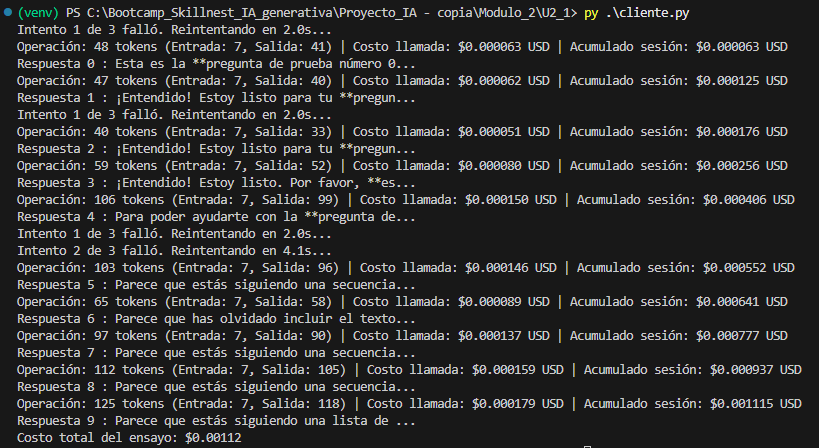

## Registro del ensayo de rate limit

- Fecha: 2026-11-12
- Peticiones enviadas: 10 (del 0 al 9)
- Petición donde apareció el primer reintento (rate limit): en la inicialización (Intento 1 de 3 falló. Reintentando en 2.0s...) y luego escalando a Intento 2 en 4.1s.
- Esperas observadas: 2.0s y 4.1s (backoff exponencial funcionando correctamente)
- Costo total del ensayo: $0.00112 USD
- Resultado: todas las peticiones terminaron con éxito tras reintentar y el costo acumulado se calculó correctamente por operación.

