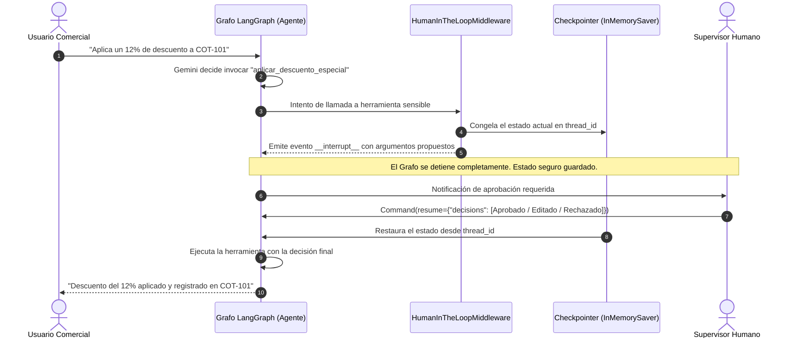

# Reporte Técnico: Arquitectura y Funcionamiento de Human-in-the-Loop (HITL) en LangGraph

**Autor:** Equipo de Desarrollo de IA / Bootcamp Generative AI  
**Fecha:** Noviembre 2026  
**Módulo Evaluado:** `src/agente_con_memoria_cotizaciones_langgraph.py`  
**Tecnologías:** LangChain v1, LangGraph, Google Gemini API, Pydantic, JSON Lines  

---

## 1. Resumen Ejecutivo y el Dilema Inicial

Durante la ejecución del agente conversacional de cotizaciones con memoria y supervisión humana, surge una duda conceptual natural:

> *«Si el patrón implementado es **Human-in-the-Loop (Humano en el Bucle)**, ¿por qué al ejecutar el script yo, como usuario humano, no tuve que realizar ninguna acción ni presionar ninguna tecla?»*

Este reporte técnico explica en profundidad por qué ocurrió esto, cómo se modela el rol del supervisor humano en pruebas automáticas frente a entornos reales de producción, cómo opera la arquitectura interna de interrupción y reanudación de **LangGraph**, y cómo habilitar la interacción humana manual en la consola.

---

## 2. La Causa Técnica: Modo Automatizado vs. Modo Interactivo

El código de [agente_con_memoria_cotizaciones_langgraph.py](file:///c:/Bootcamp_Skillnest_IA_generativa/Proyecto_IA/src/agente_con_memoria_cotizaciones_langgraph.py) cuenta con un diseño híbrido pensado tanto para **desarrollo interactivo** como para **pruebas continuas (CI/CD)**.

### 2.1 La Inyección de `decision_manual`
En el bloque de ejecución de prueba (`if __name__ == "__main__":`), la **Prueba 3** se invocó con un parámetro explícito:

```python
r_hitl = ejecutar_con_hitl(
    "Aplica un 12% de descuento especial a la cotización COT-101.",
    cfg_hilo_1,
    decision_manual={"type": "approve"},  # <-- INYECCIÓN PROGRAMÁTICA
)
```

Al pasar `decision_manual={"type": "approve"}`, el script **simuló la acción humana de forma automática**.

### 2.2 La Bifurcación en `ejecutar_con_hitl`
Dentro de la función orquestadora, existe una estructura condicional que decide si pedir datos al teclado o usar la decisión simulada:

```python
# Si NO se pasó una decisión previa, el programa se detiene y pide teclado al humano:
if decision_manual is None:
    raw = input("¿Aprobar descuento? (a = approve / e = edit / r = reject): ").strip().lower()
    if raw == "a":
        decision = {"type": "approve"}
    elif raw == "e":
        nuevo_pct = float(input("Nuevo porcentaje de descuento: ").strip())
        cod = input("Código de cotización (ej. COT-101): ").strip().upper()
        decision = {
            "type": "edit",
            "edited_action": {
                "name": "aplicar_descuento_especial",
                "args": {"codigo_cotizacion": cod, "porcentaje_descuento": nuevo_pct},
            },
        }
    else:
        decision = {"type": "reject", "message": "Descuento rechazado por política comercial."}

# Si se proporcionó decision_manual, se adopta esa decisión sin pausar:
else:
    decision = decision_manual
```

> **Conclusión:** El agente **sí pausó y sí aplicó la lógica de interrupción HITL**. Sin embargo, la resolución de esa pausa se resolvió mediante código inyectado en milisegundos para permitir que la suite de pruebas finalizara de forma autónoma.

---

## 3. Arquitectura Interna de HITL en LangGraph

A diferencia de los agentes tradicionales (donde se intentaba meter un `input()` bloqueando hilos del sistema operativo), LangGraph implementa un **patrón de interrupción por estado determinista y serializable**.



### Componentes Clave:
1. **`HumanInTheLoopMiddleware`:**  
   Se configura durante la creación del agente (`create_agent`) mediante el diccionario `interrupt_on`. En nuestro sistema:
   * `consultar_cotizacion_detallada`: **False** (Solo lectura, corre libremente).
   * `calcular_subtotal_cotizacion`: **False** (Cálculo matemático, corre libremente).
   * `aplicar_descuento_especial`: **Interrupción activa** (Modifica precios, requiere revisión).
2. **`InMemorySaver` (Checkpointer):**  
   Al llegar a la interrupción, todo el estado de la conversación, variables y pasos de herramientas se congelan en memoria indexados por el `thread_id`.
3. **`Command(resume=...)`:**  
   Es la primitiva que reactiva el grafo en el punto exacto donde se detuvo, pasando la decisión del supervisor humano.

---

## 4. Las Tres Acciones Humanas Posibles

El middleware define `allowed_decisions: ["approve", "edit", "reject"]`. Cada una produce un comportamiento radicalmente diferente en el agente:

| Decisión | Carga Útil (Payload) | Comportamiento del Agente |
| :--- | :--- | :--- |
| **Aprobar (`approve`)** | `{"type": "approve"}` | El agente ejecuta la herramienta con los parámetros exactos que propuso el LLM (descuento del 12% a COT-101). |
| **Rechazar (`reject`)** | `{"type": "reject", "message": "..."}` | El agente **no** ejecuta la herramienta. Se inyecta un mensaje de error comercial en el contexto y el modelo explica al usuario por qué no se pudo conceder el descuento. |
| **Editar (`edit`)** | `{"type": "edit", "edited_action": {"name": "...", "args": {...}}}` | El humano sobreescribe los parámetros. Por ejemplo, el cliente pidió 12%, pero el supervisor ajusta los argumentos a 5%. El agente ejecuta la herramienta con el 5%. |

---

## 5. HITL en Producción Empresarial (Mundo Real)

En una empresa real (un ERP de cotizaciones, un CRM de ventas o una aplicación web):

1. **Desacoplamiento Asíncrono:**  
   El cliente web no se queda esperando frente a una terminal de consola. El usuario hace la solicitud en la web y el servidor guarda el estado congelado con su `thread_id` en una base de datos persistente (reemplazando `InMemorySaver` por `PostgresSaver`).
2. **Canales de Supervisión Humana:**  
   * **Slack / Microsoft Teams:** Un webhook envía un mensaje interactivo con botones: `[Aprobar 12%]`, `[Rechazar]`, `[Ajustar %]`.
   * **Panel Administrativo (Dashboard):** Una bandeja de entrada para gerentes comerciales con las cotizaciones pendientes de revisión.
3. **Reanudación del Backend:**  
   Cuando el gerente hace clic en el botón de su pantalla, el backend de la empresa recibe la petición HTTP y ejecuta:
   ```python
   agente.invoke(
       Command(resume={"decisions": [{"type": "approve"}]}),
       config={"configurable": {"thread_id": id_cliente}}
   )
   ```
   El cliente recibe la confirmación en su pantalla segundos o minutos después.

---

## 6. Auditoría, Gobernanza y Cumplimiento (Compliance)

En sistemas comerciales donde se manejan precios, dinero y descuentos, la autonomía total de la IA es un riesgo crítico de negocio.

El código implementa dos capas de auditoría obligatorias:
1. **Auditoría en Memoria (`registro_aprobaciones`):**  
   Guarda quién, cuándo (`timestamp`), qué herramienta y qué argumentos exactos fueron autorizados.
2. **Caja Negra Persistente (`trazas_cotizaciones_modernas.jsonl`):**  
   Registra en formato JSON Lines cada interacción, permitiendo auditorías posteriores ante discrepancias comerciales con clientes o auditorías contables.

---

## 7. Guía Práctica: Cómo probar la intervención humana en vivo

Para experimentar la intervención humana manual en tu propia máquina:

1. Abre el archivo [src/agente_con_memoria_cotizaciones_langgraph.py](file:///c:/Bootcamp_Skillnest_IA_generativa/Proyecto_IA/src/agente_con_memoria_cotizaciones_langgraph.py).
2. Ve a las líneas finales (Prueba 3) y elimina el argumento `decision_manual`:

```python
# ANTES:
r_hitl = ejecutar_con_hitl(
    "Aplica un 12% de descuento especial a la cotización COT-101.",
    cfg_hilo_1,
    decision_manual={"type": "approve"},
)

# AHORA (Modo Humano Real):
r_hitl = ejecutar_con_hitl(
    "Aplica un 12% de descuento especial a la cotización COT-101.",
    cfg_hilo_1,
)
```

3. Ejecuta en PowerShell:
   ```powershell
   py .\src\agente_con_memoria_cotizaciones_langgraph.py
   ```
4. Verás cómo el programa se congela y solicita tu intervención:
   ```text
   [PAUSA HITL] Interrupción detectada: {'action_requests': [{'name': 'aplicar_descuento_especial', 'args': {'codigo_cotizacion': 'COT-101', 'porcentaje_descuento': 12}}]}
   ¿Aprobar descuento? (a = approve / e = edit / r = reject): 
   ```
5. Prueba presionando **`r`** (Rechazar) para ver cómo el agente responde que la política comercial impidió el descuento, o **`e`** para cambiar el porcentaje tú mismo.
